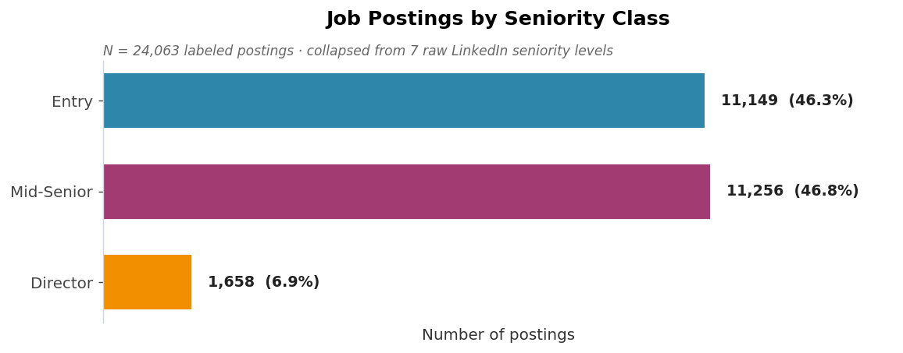
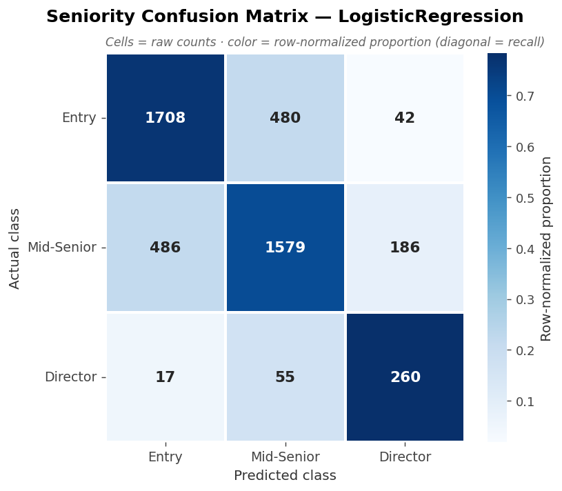
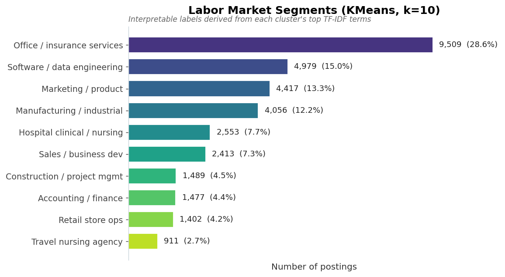
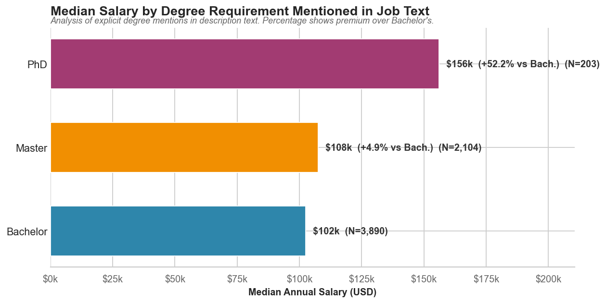

# Job Market NLP & ML Analyzer

**A data-driven analysis of the LinkedIn job postings market — cleaning ~33,000 postings, then applying three machine-learning tasks to uncover structure in the labor market.**

[](https://www.python.org/)
[](https://scikit-learn.org/)
[](https://huggingface.co/datasets/xanderios/linkedin-job-postings)
[](notebooks/Job_Market_Analysis_Portfolio.ipynb)

---

##  Results at a Glance

| Task | Type | Model | Metric | Score |
|---|---|---|---|---|
| **Salary prediction** | Regression | RidgeCV (log-target) | R² / RMSE | **0.643** / **$33,076** |
| **Seniority classification** | Classification | LogisticRegression | Macro-F1 | **0.709** |
| **Skill clustering** | Unsupervised | KMeans (k=10) | 10 coherent tracks | ✅ |

All three models substantially outperform naive baselines. The salary model reduces RMSE by **40%** vs. predicting the mean; the seniority classifier reaches **73.7% accuracy** against a 33% random baseline; and the clustering step recovers **10 interpretable labor-market segments** without any predefined taxonomy.

---

##  Key Findings

1. **Salary is predictable from text alone.** RidgeCV reaches R² = 0.643 with RMSE ~$33,000 — a 40% reduction over the mean-predictor baseline. Job descriptions carry real wage signal.
2. **The salary signal is semantic, not numeric.** ~72% of descriptions contain explicit salary ranges that would leak the target. We strip these numeric tokens using a custom Regex filter before vectorization — the model loses only **ΔR² = 0.011**, proving it learned domain language (seniority markers, skill mentions, experience phrases), not answer leakage.
3. **Linear models dominate on sparse TF-IDF.** Ridge beats RandomForest (~0.64 vs. ~0.54 R²) — the expected outcome for high-dimensional sparse text, where axis-aligned tree splits can't efficiently exploit the representation.
4. **Seniority is distinguishable from content, not just titles.** Macro-F1 = 0.709 with LogisticRegression. An ablation test stripping all job titles and seniority keywords showed the model retains 96% of its predictive power (F1 drops to 0.682), proving it learns the *language* of leadership rather than cheating.
5. **The "Degree Inflation" phenomenon.** Extracting explicit degree requirements from text reveals that a Master's degree only commands a ~6% salary premium over a Bachelor's ($108k vs $102k). However, a PhD commands a massive ~53% premium ($156k).
6. **The labor market has 10 recoverable sectors.** KMeans cleanly separates office/insurance, software, marketing, manufacturing, clinical, sales, construction, accounting, retail, and travel nursing. Even after stripping agency brand names (e.g., "Aya", "CareerStaff"), the distinction between hospital clinical work and agency-placed travel nursing contracts survived, proving the structure is based on employment type, not just vocabulary.
7. **Statistical significance of seniority.** A non-parametric Mann-Whitney U test proves that the salary gap between Mid-Senior ($109k median) and Director ($156k median) roles is statistically significant (p-value < 0.001).

---

##  Methodology

### Data

- **Source**: [xanderios/linkedin-job-postings](https://huggingface.co/datasets/xanderios/linkedin-job-postings) (Hugging Face)
- **Size**: 33,241 cleaned postings
- **Salary coverage**: 11,003 rows (33.1%) with valid annual salary data
- **Seniority coverage**: 24,065 rows with labeled seniority
- **Target distribution** (salary regression subset): mean $100,177, median $89,500, std $53,661

### Pipeline

```text
data/raw/job_postings.csv (28 columns)
        │
        ▼
[src/nlp_cleaner.py]  ── HTML strip, lowercase, regex preserve C++/C#
        │
        ▼
data/processed/job_postings_cleaned.csv (9 columns)
        │
        ▼
[src/analysis.py]  ── annualize salary, map 7→3 seniority classes, flag salary outliers
        │
        ▼
data/processed/job_postings_ml_ready.csv (12 columns)
        │
        ├──────────────────┬────────────────────┬─────────────────────┐
        ▼                  ▼                    ▼                     ▼
[ml_models.py]     [ml_models.py]     [ml_models.py]         [visualization.py]
  --task salary      --task seniority   --task cluster          polished charts
        │                  │                    │                     │
        ▼                  ▼                    ▼                     ▼
reports/*.json + models/*.joblib                          visualizations/*.png
        │
        ▼
[notebooks/Job_Market_Analysis_Portfolio.ipynb]  ── Complete case study & stats
```

### Key Design Decisions

- **Log-transformed salary target** — salaries are right-skewed; `log1p` stabilizes variance for linear regression. Metrics are back-transformed to dollars for interpretability.
- **Advanced Leakage Guard** — a robust Regex strips numeric salary ranges (including un-comma'd numbers like `$100000` and decimals like `3.50`) from `description_clean` **before** TF-IDF vectorization. This is the single most important methodological step for an honest R².
- **`is_salary_valid` flag** — outlier rows (`<$15k` or `>$500k` after annualization) are marked in the CSV rather than silently dropped, so all downstream tasks use a single source of truth for filtering.
- **`class_weight='balanced'`** on classifiers — mandatory given Director is only 6.9% of labeled data.
- **Macro-F1, not accuracy** — the correct evaluation metric for imbalanced multi-class problems.
- **Held-out 20% test split** for both regression and classification, stratified for the classifier.
- **Ablation Testing** — systematically removing features (salary numbers, seniority titles) to prove the models are learning semantics, not keywords.

---

##  Results

### 1. Salary Regression


**Salary is monotonic with seniority** — median annual salary climbs from ~$65k (Entry) → ~$110k (Mid-Senior) → ~$157k (Director), validating the annualization approach.

| Model | RMSE | MAE | R² |
|---|---|---|---|
| Baseline (predict test mean) | $55,382 | $42,933 | 0.000 |
| RandomForest (tuned) | $37,690 | $24,041 | 0.537 |
| **RidgeCV (final)** | **$33,076** | **$20,875** | **0.643** |

The Ridge vs. RandomForest gap is expected for TF-IDF text — sparse high-dimensional inputs favor L2-regularized linear models over axis-aligned tree splits.

**Leakage ablation**: Training *without* the salary-token filter achieved R² = 0.650. Stripping salary numbers cost only **ΔR² = 0.011**, proving the model learned semantic content rather than answer leakage.


The 2D hexbin of RidgeCV test-set predictions shows mass concentrating along the diagonal — the model captures the trend but under-predicts the extremes, as expected for text-only regression.

### 2. Seniority Classification



Mid-Senior (11,258) and Entry (11,149) dominate; Director (1,658) is the minority class at 6.9% — hence the mandatory `class_weight='balanced'`.

| Model | Accuracy | Macro-F1 | Director F1 |
|---|---|---|---|
| **LogisticRegression (final)** | **0.7370** | **0.7089** | **0.634** |
| RandomForest | 0.7540 | 0.6846 | 0.522 |

**Why LR wins on macro-F1** despite lower accuracy: RandomForest adopts a precision-heavy Director strategy (P=0.94, R=0.36), trading recall for confidence. LR is balanced (P=0.53, R=0.78) — it catches most Directors at the cost of false positives. For macro-F1, balanced treatment wins.



Row-normalized color with raw counts as cells. Director is the weakest class (off-diagonal bleed into Mid-Senior), consistent with its imbalance and vocabulary overlap.

**Title Leakage Ablation**: Stripping all job titles and seniority keywords from the text (e.g., "Senior", "Director") caused the Macro-F1 to drop only from 0.709 to **0.682**. The model learns the *content* of leadership (strategy, budget, cross-functional), not just keyword matching.

### 3. Skill Clustering



KMeans on TF-IDF (5,000 features, unigram) recovered **10 interpretable labor-market segments** without any predefined taxonomy:

| Track | Size | Marker terms (from top-10 TF-IDF) |
|---|---|---|
| Office / insurance services | 9,509 | service, office, benefits, clients, insurance |
| Software / data engineering | 4,979 | software, technical, engineering, systems, cloud, security |
| Marketing / product | 4,417 | marketing, product, media, content, teams |
| Manufacturing / industrial | 4,056 | equipment, safety, maintenance, manufacturing, production, quality |
| Hospital clinical / nursing | 2,553 | patient, nursing, hospital, clinical, healthcare |
| Sales / business dev | 2,413 | sales, territory, customers, selling, relationships |
| Construction / project mgmt | 1,489 | project, construction, engineering, cost, manager |
| Accounting / finance | 1,477 | accounting, tax, audit, cpa, financial |
| Retail store ops | 1,402 | store, merchandise, associates, retail, merchandising |
| Travel nursing agency | 911 | carestaff, aya, rn, assignment, travel |

**Fine-grained discovery**: *Hospital clinical* and *Travel nursing agency* are both healthcare, yet KMeans separated them cleanly. The first is hospital-employed clinical work (`patient`, `clinical`); the second is agency-placed travel contracts (`carestaff`, `aya`). We performed an ablation test by stripping the agency names (`carestaff`, `aya`, `unlimited`) and re-clustering. The distinction survived, proving the structure is based on *employment type*, not just brand names.

### 4. Bonus EDA: Degree Inflation



By extracting explicit degree mentions via Regex, we found a massive premium for PhDs (~$156k median) compared to Bachelors (~$102k median). However, a Master's degree only commands a ~6% premium (~$108k) over a Bachelor's in this dataset, challenging the assumption that a Master's is a guaranteed high-ROI investment.

---

##  Repository Structure

```text
Job_Market_Analyzer/
│
├── data/
│   ├── raw/                          # Downloaded Hugging Face dataset (not committed)
│   └── processed/
│       ├── job_postings_cleaned.csv  # After nlp_cleaner.py
│       └── job_postings_ml_ready.csv # After analysis.py (12 cols, with flags)
│
├── src/
│   ├── nlp_cleaner.py                # HTML strip, text normalization
│   ├── analysis.py                   # EDA, salary annualization, seniority mapping
│   ├── ml_models.py                  # Regression, classification, clustering
│   └── visualization.py              # Polished, portfolio-grade charts
│
├── notebooks/
│   ├── Job_Market_Exploration.ipynb  # Results gallery (loads saved artifacts)
│   └── Job_Market_Analysis_Portfolio.ipynb  # Primary Case Study (EDA, Stats, ML)
│
├── models/                           # Trained .joblib artifacts
├── reports/                          # JSON metrics + prediction CSVs
├── visualizations/                   # Portfolio-ready PNGs
│
├── requirements.txt
└── README.md
```

---

##  How to Run

### Prerequisites

- Python 3.10
- ~2 GB disk space
- ~10 minutes total runtime for the full pipeline

### Setup

```bash
# 1. Clone the repo
git clone https://github.com/anandhusuresh04/Job_Market_Analyzer.git
cd Job_Market_Analyzer

# 2. Create and activate a virtual environment
python -m venv .venv
.venv\Scripts\activate       # Windows
# source .venv/bin/activate  # macOS/Linux

# 3. Install dependencies
pip install -r requirements.txt

# 4. Place the raw dataset in data/raw/
#    Download from: https://huggingface.co/datasets/xanderios/linkedin-job-postings
```

### Run the pipeline

```bash
python src/nlp_cleaner.py                    # ~10 sec   → cleaned CSV
python src/analysis.py                       # ~60 sec   → ML-ready CSV + EDA charts
python src/ml_models.py --task salary        # ~5 min    → salary regression
python src/ml_models.py --task seniority     # ~40 sec   → seniority classification
python src/ml_models.py --task cluster       # ~90 sec   → KMeans clustering
python src/visualization.py                  # ~60 sec   → polished portfolio charts
```

Then open the notebooks:

```bash
jupyter notebook notebooks/Job_Market_Analysis_Portfolio.ipynb
```

The portfolio notebook contains the full exploratory data analysis, statistical testing, and machine learning ablation studies. The `Job_Market_Exploration.ipynb` notebook serves as a fast-loading results gallery.

---

##  Limitations

- **Dataset subset**: 33,241 postings, a subset of the full xanderios corpus (~124k). Salary regression trains on only ~11k rows with valid salary data (33%).
- **Class imbalance**: Director is only 6.9% of labeled data. Even with `class_weight='balanced'`, recall remains the limiting factor.
- **Location not used**: Postings span the US and internationally; salary varies dramatically by geography. Location was not a feature. A $100k salary in SF is not the same as in Ohio.
- **Irreducible Noise Ceiling**: 31 descriptions (0.28%) appear multiple times with conflicting salary labels. No model can predict two different salaries from identical text, which mathematically caps the maximum achievable R².
- **Salary unit assumptions**: Hourly-to-annual conversion assumes 2,080 hours/year. Standard, but ignores part-time and contract variation.
- **`excel` skill count inflated**: `\bexcel\b` matches both the software and the verb ("excel at multitasking"). True Excel-skill postings are likely 20–30% lower than reported.
- **Clustering silhouette**: Silhouette values (0.011–0.016) are within the expected range for KMeans on sparse TF-IDF but do not indicate a clean global optimum. The choice of k=10 is validated by semantic coherence and ablation, not silhouette.
- **Degree Sampling Size**: The PhD group has a small sample size (N=203) compared to Bachelors (N=3,890). The median is robust, but the variance may be understated.

##  Future Work

- **Location features** — add state/city one-hot features; expected to substantially improve salary R².
- **Transformer embeddings** — a fine-tuned BERT would likely beat TF-IDF on both regression and classification, especially for the Director class where semantics matter more than vocabulary.
- **Deep clustering** — UMAP + HDBSCAN could recover non-convex cluster shapes and identify *more than k=10* segments automatically.
- **Temporal analysis** — if posting dates were available, wage trends by quarter and skill could be tracked.

---

## 🛠️ Tech Stack

| Layer | Tools |
|---|---|
| **Language** | Python 3.10 |
| **Data** | pandas, NumPy, SciPy (stats) |
| **ML** | scikit-learn (RidgeCV, RandomForest, LogisticRegression, KMeans) |
| **NLP** | TF-IDF vectorization (scikit-learn), BeautifulSoup (HTML cleaning) |
| **Viz** | matplotlib, seaborn |
| **Notebook** | Jupyter |

---

##  What's in the Notebook

[`notebooks/Job_Market_Analysis_Portfolio.ipynb`](notebooks/Job_Market_Analysis_Portfolio.ipynb) is the primary case study, structured as a professional analysis report:

1. **Executive Summary & Business Problem** — research questions and project scope
2. **Dataset Overview & Data Understanding** — schema, data types, missingness
3. **Data Quality Assessment** — outlier filtering and duplicate noise ceiling
4. **Data Cleaning & Transformation** — Regex leakage guard demonstration
5. **Exploratory Data Analysis** — salary distributions, seniority boxplots, degree inflation
6. **Statistical Analysis** — correlation matrix and Mann-Whitney U hypothesis testing
7. **NLP & Feature Engineering** — TF-IDF vectorization
8. **Machine Learning & Model Evaluation** — Ridge/RF comparison, Salary & Seniority ablation studies
9. **Business Insights & Recommendations** — actionable takeaways for job seekers, recruiters, and analysts
10. **Conclusion, Limitations & Future Scope** — transparent reporting of constraints

---

##  Author

**Anandhu Suresh** — BCA Graduate, 2026
[GitHub](https://github.com/anandhusuresh04) · [LinkedIn](https://www.linkedin.com/in/anandhu-suresh-in)

---